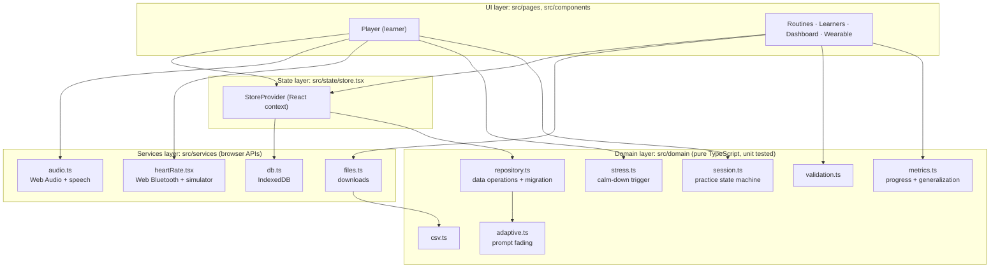
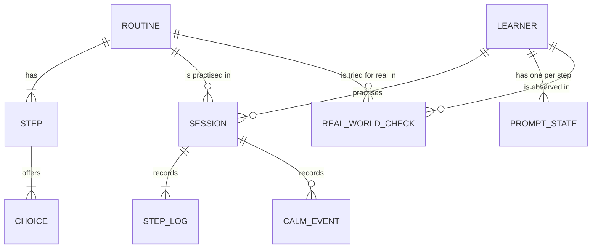
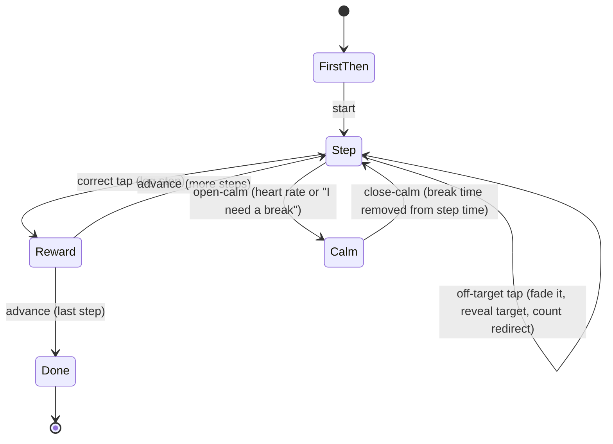

# LifeSync design

## 1. Architecture

LifeSync is a single-page web app (React 18, TypeScript, Vite) that runs fully in the browser.
The code is split into layers so the logic that matters can be tested without a browser.

**Rule:** `domain/` never imports React or a browser API. Pages hold layout and wiring; every
decision (what happens on a tap, when to open the calm screen, what counts as a generalization gap)
lives in a pure function with tests.

## 2. Data model

All of it is one `AppData` object (`domain/types.ts`) saved to IndexedDB. Photos and videos are
stored separately as blobs, keyed by `mediaId`, so the JSON stays small. `AppData.version` lets
`migrate()` upgrade older saves and backups (version 1 had no real-world check-ins).

## 3. Practice session state machine

`domain/session.ts` is a reducer. The Player sends it events; it returns the next state.

Prompt levels and choice order are frozen when the session starts (`buildPlan`), so nothing shifts
under the learner mid-routine.

## 4. Algorithms

**Adaptive prompting** (`adaptive.ts`): most-to-least prompting. New steps start at Full help.
Two clean completions in a row fade help one level; two or more redirects, or a calm break during
the step, bring one level back. A single redirect resets the streak without adding help.

**Calm-down trigger** (`stress.ts`): heart rate must stay at or above the learner's threshold for
their full hold time (default 5 s) before the calm screen opens, which filters out one-off spikes
and sensor noise. After it fires it disarms until heart rate drops back under the threshold, so it
can't fire again the moment a break ends.

**Generalization gap** (`metrics.ts`): for each routine, _app mastery_ is the share of steps at
Delayed or Independent help, and _real-world rate_ is the share of the last three real-world tries
done on their own. Mastery ≥ 80% with real-world rate < 50% is flagged as a **generalization gap**,
which tells the team to practise in the real place and check that the photos match it.

## 5. Design decisions

| Decision                                     | Alternatives considered              | Why                                                                                                                                                                         |
| -------------------------------------------- | ------------------------------------ | --------------------------------------------------------------------------------------------------------------------------------------------------------------------------- |
| Browser app, no backend                      | Native app; app + server             | Runs on any school device, no install, works offline for a TSA demo with no Wi-Fi, and student data never leaves the device. A backend is planned once accounts are needed. |
| IndexedDB for storage                        | localStorage                         | localStorage holds ~5 MB of strings only; IndexedDB stores photo and video blobs directly.                                                                                  |
| Pure reducer for the session                 | State spread across `useState` hooks | One place for the rules, testable without rendering, easy to explain to judges.                                                                                             |
| Rule-based adaptive prompting                | Machine learning model               | No training data yet, and teachers need to understand why help changed. The rule is one pure function, so a model can replace it later.                                     |
| Web Bluetooth heart-rate profile + simulator | Apple HealthKit / Fitbit API         | Those need a native app and accounts. The standard Bluetooth profile works with chest straps and many watches; the simulator makes demos reliable.                          |
| Errorless correction                         | Showing "wrong"                      | Error feedback raises anxiety and can teach the wrong answer; errorless learning is the method in the brief.                                                                |

## 6. User-centred design for autistic learners

- **Predictable layout:** every step has the same layout: progress dots, Now/Next, picture,
  instruction, choices.
- **Sensory-friendly:** muted low-saturation palette, no flashing or error sounds, videos muted by
  default, all motion turned off under `prefers-reduced-motion`.
- **Motor-accessible:** tap only, choice buttons at least 96 px tall, no drag or pinch.
- **Language support:** short instructions, emoji backup when there's no photo, read-aloud.
- **Control:** an "I need a break" button on every step; leaving needs a deliberate 2-second press.
- **Grown-up and learner areas are separate,** so learners only see what they need.
